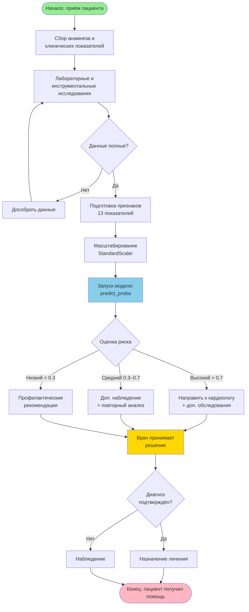
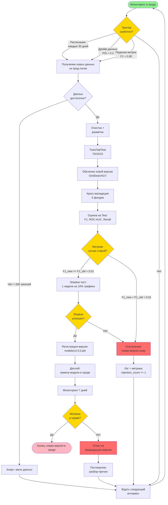

# BPMN-диаграммы: Heart Disease Prediction

Документ содержит две BPMN-диаграммы:

1. **Использование модели в проекте** — как модель применяется в реальном процессе диагностики
2. **Процесс автоматического переобучения** — ДЗ №3 (триггеры, шаги, критерии остановки)

---

## Часть 1. BPMN использования модели в проекте

### Описание процесса

Модель встраивается в **клинический процесс** как **вспомогательный инструмент**.
Врач вводит данные пациента → модель даёт оценку риска → врач принимает решение.

### Диаграмма

### Ключевые элементы

| Элемент | Тип | Что делает |
|---------|-----|------------|
| Начало | Start Event | Приём пациента |
| Сбор анамнеза | Task | Врач собирает 13 показателей |
| Данные полные? | Gateway | Проверка полноты |
| Масштабирование | Task | `StandardScaler` из `models/scaler.pkl` |
| **Запуск модели** | Task | `predict_proba` → вероятность |
| Оценка риска | Gateway | 3 ветки: высокий / средний / низкий |
| Врач принимает решение | Task | **Финальное решение — за врачом** |
| Диагноз подтверждён? | Gateway | Проверка |
| Конец | End Event | Пациент получил помощь |

### Триггеры использования модели

- **Вход в клинику** — новый пациент с подозрением на ССЗ
- **Плановый осмотр** — профилактический скрининг
- **Повторный визит** — динамика показателей

### Как измеряется количество переобучений

В **процессе использования** модели переобучения **не происходит** — модель
**статична**, работает с фиксированными весами. Переобучение — отдельный
процесс (см. Часть 2).

**Метрики использования:**
- Количество предсказаний в день/неделю/месяц
- Распределение предсказанных классов (баланс)
- **Drift** — расхождение входных данных с обучающими

### Критерии остановки (защита от бесконечного цикла)

В процессе **использования** бесконечного цикла **нет** — процесс линейный.
Но есть **петля** «Данные не полные → дособрать → проверить снова». Защита:

- **Максимум 3 итерации** сбора данных
- Если после 3 итераций данные не полные → **направить к врачу без модели**
- **Timeout:** если модель не отвечает > 5 сек → fallback на клинические правила

---

## Часть 2. BPMN процесса автоматического переобучения модели (ДЗ №3)

### Описание процесса

Переобучение запускается **по триггеру** (расписание, дрейф данных, падение
метрик). Новая версия проходит **валидацию** — если лучше старой, публикуется.
Иначе — **откат** и алерт.

### Диаграмма

### Пошаговое описание

#### 1. Триггер переобучения

Переобучение запускается **по одному из трёх триггеров**:

| Триггер | Условие | Частота |
|---------|---------|---------|
| **Расписание** | Каждые **30 дней** | Автоматически по cron |
| **Дрейф данных** | **PSI > 0.2** (Population Stability Index) | При обнаружении сдвига |
| **Падение метрик** | **F1 < 0.85** на live-данных | При деградации |

**Результат:** сигнал на запуск пайплайна переобучения.

#### 2. Получение и подготовка новых данных

- **Сбор:** прод-логи (пациенты, предсказания, фактические исходы)
- **Проверка объёма:** если **< 500 записей** → алерт, выход
- **Очистка:** удаление дубликатов, обработка пропусков
- **Разметка:** фактические диагнозы от врачей

**Результат:** чистый датасет с новыми данными.

#### 3. Обучение новой версии модели

- **Разделение:** 70% train / 15% val / 15% test
- **Обучение:** тот же AutoML (4 модели, GridSearchCV)
- **Кросс-валидация:** StratifiedKFold 5 фолдов

**Результат:** новая модель + метрики на CV.

#### 4. Проверка качества модели

- **Оценка на Test:** F1, ROC-AUC, Recall
- **Сравнение со старой:** `F1_new >= F1_old + 0.01` (минимум +1%)

**Результат:** решение «публиковать / отклонить».

#### 5. Принятие решения о публикации

| Условие | Действие |
|---------|----------|
| `F1_new >= F1_old + 0.01` | **Shadow-тест** |
| `F1_new < F1_old + 0.01` | **Отклонение** → лог, `rejection_count += 1` |

**Результат:** переход к shadow-тесту или возврат в ожидание.

#### 6. Shadow-тест (промежуточная проверка)

- Новая модель работает **параллельно** со старой
- Получает **10% трафика**
- Длится **1 неделю**
- Метрики сравниваются **на живых данных**

**Результат:** подтверждение или отклонение.

#### 7. Регистрация и сохранение версии

- **Версионирование:** `models/heart_disease_model_v2.0.0.pkl`
- **Метаданные:** дата, метрики, гиперпараметры
- **Реестр:** `models/registry.json` (все версии)

**Результат:** новая версия в реестре.

#### 8. Деплой модели

- **Замена:** прод-модель → новая версия
- **Zero-downtime:** старая версия остаётся как fallback
- **Мониторинг 7 дней**

**Результат:** новая версия в проде.

#### 9. Действия при неуспехе

| Этап | Что делать |
|------|-----------|
| Мало данных | Алерт, ждать следующий триггер |
| Метрики хуже | Лог, `rejection_count += 1`, ждать |
| Shadow-тест провален | Откат, разбор причин |
| Метрики в проде упали | **Откат** на предыдущую версию + постмортем |

**Результат:** система вернулась в стабильное состояние.

### Как измеряется количество переобучений

| Метрика | Что показывает |
|---------|----------------|
| `retrain_attempts` | Всего попыток переобучения |
| `retrain_success` | Успешных публикаций |
| `retrain_rejected` | Отклонённых (метрики хуже) |
| `retrain_rollback` | Откатов после деплоя |
| **`retrain_frequency`** | Среднее время между переобучениями |

### Критерии остановки (защита от бесконечного цикла)

Процесс переобучения **потенциально циклический** (триггер → обучение →
отклонение → ждать → снова триггер). Защита от бесконечного цикла:

| Критерий | Значение | Действие |
|----------|----------|----------|
| **Максимум попыток** | 3 подряд неудачных | Пауза 7 дней |
| **Cooldown** | 24 часа между попытками | Принудительная пауза |
| **Timeout обучения** | 30 минут | Прерывание, лог |
| **Timeout shadow** | 7 дней | Принудительное решение |
| **Стоимость** | > $100 за попытку | Стоп + алерт |
| **Дрейф не найден** | 3 проверки подряд | Отключить триггер дрейфа на 30 дней |

**При достижении лимита:** система **останавливается**, отправляет алерт
команде ML-инженеров, ждёт **ручного вмешательства**.

### Результат каждого этапа (сводка)

| Этап | Вход | Выход |
|------|------|-------|
| Триггер | Мониторинг | Сигнал на переобучение |
| Сбор данных | Прод-логи | Чистый датасет |
| Обучение | Датасет | Новая модель + CV-метрики |
| Проверка | Новая модель | Решение «публиковать / нет» |
| Shadow | Модель + 10% трафика | Подтверждение / отклонение |
| Регистрация | Успешный shadow | Версия в реестре |
| Деплой | Версия в реестре | Модель в проде |
| Мониторинг | Прод | Решение «оставить / откатить» |

---

## Связь с проектом

| Компонент проекта | Роль в BPMN |
|-------------------|-------------|
| `src/automl_pipeline.py` | Обучение (этап 3) |
| `src/config.py` | Пороги триггеров (`cv_folds`, `random_state`) |
| `src/data_preprocessing.py` | Подготовка данных (этап 2) |
| `models/heart_disease_model.pkl` | Регистрация версии (этап 7) |
| `results/model_comparison.csv` | Метрики для проверки (этап 4) |
| `.github/workflows/ci-cd.yml` | Автоматизация переобучения |

**Связанные документы:**
- [README.md](README.md) — общее описание проекта
- [model_card.md](model_card.md) — паспорт модели
