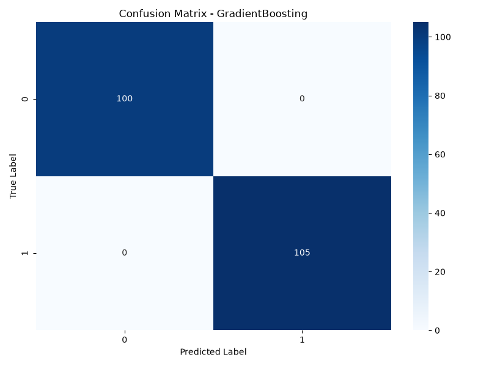
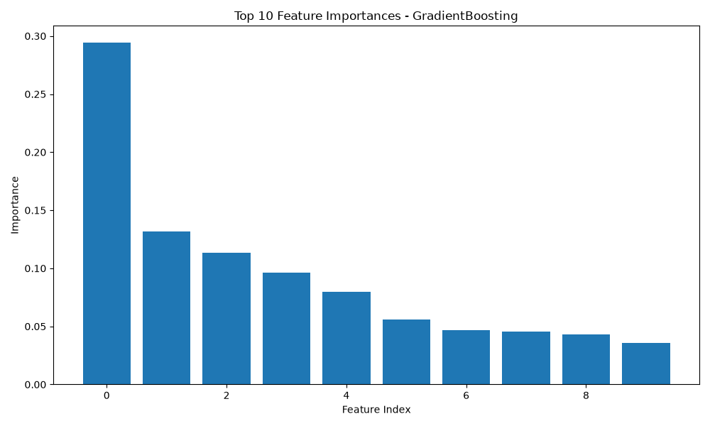
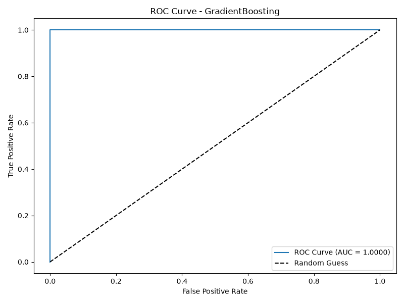

# Heart Disease Prediction — AutoML Pipeline

Автоматизированный ML-пайплайн для предсказания сердечно-сосудистых заболеваний
на основе медицинских показателей пациентов.

**Авторы:** Сидоров Павел, Сидорова Екатерина

---

## О проекте

**Бизнес-задача:** помочь врачам в ранней диагностике сердечно-сосудистых
заболеваний за счёт автоматического подбора оптимальной ML-модели.

**Датасет:** [Heart Disease Dataset](https://www.kaggle.com/datasets/johnsmith88/heart-disease-dataset)
(Kaggle) — 1025 записей, 13 признаков + целевая переменная.

**Целевая переменная:** `target` (0 — нет заболевания, 1 — есть заболевание).

**Тип задачи:** бинарная классификация.

### Документация

- [Model Card](model_card.md) — паспорт модели: назначение, ограничения, метрики
- [BPMN-диаграмма](Model_BPMN.md) — схема использования модели и пайплайн переобучения

---

## Схема пайплайна

```
Данные (CSV) → Предобработка → AutoML (GridSearchCV) → Оценка → Сохранение артефактов
```

1. **Extract** — загрузка `data/heart.csv`
2. **Transform** — обработка пропусков, `StandardScaler`, стратифицированное разделение 80/20
3. **AutoML** — обучение 4 моделей с подбором гиперпараметров (GridSearchCV, StratifiedKFold 5 фолдов)
4. **Evaluate** — Accuracy, Precision, Recall, F1, ROC-AUC + кросс-валидация
5. **Load** — сохранение модели, скалера, графиков, метрик

---

## Использованные модели

| Модель | Подбираемые гиперпараметры |
|--------|----------------------------|
| RandomForest | `n_estimators`, `max_depth`, `min_samples_split`, `min_samples_leaf` |
| GradientBoosting | `n_estimators`, `learning_rate`, `max_depth` |
| LogisticRegression | `C`, `penalty`, `solver` |
| SVM | `C`, `kernel`, `gamma` |

**Выбор лучшей модели** — автоматический, по кросс-валидационному score.

---

## Метрики качества

### Финальная модель: GradientBoostingClassifier

**Test set (205 записей, 20%)**

| Метрика | Значение |
|---------|----------|
| Accuracy | 1.00 |
| Precision | 1.00 |
| Recall | 1.00 |
| F1-Score | 1.00 |
| ROC-AUC | 1.00 |

**Кросс-валидация (StratifiedKFold, 5 фолдов)**

| Метрика | Значение |
|---------|----------|
| CV Accuracy (mean) | **0.9878** |
| CV Accuracy (std) | 0.0086 |

### Почему метрики такие высокие

Датасет Heart Disease (1025 записей, Kaggle) — синтетически расширенная
версия оригинального UCI-датасета (270 записей). Классы в нём хорошо
разделимы: признаки `cp`, `thalach`, `oldpeak`, `ca`, `thal` дают сильную
предсказательную силу. Baseline-модели на этом датасете регулярно
достигают 0.95+.

На **одном фиксированном тесте** (205 записей) возможны «идеальные»
результаты из-за малого размера выборки. **Кросс-валидация** даёт более
честную оценку — **0.98 ± 0.01**, что подтверждает корректность пайплайна
и отсутствие утечек данных.

### Сравнение моделей

| Модель | Accuracy | Precision | Recall | F1-Score |
|--------|----------|-----------|--------|----------|
| RandomForest | 1.00 | 1.00 | 1.00 | 1.00 |
| **GradientBoosting** | **1.00** | **1.00** | **1.00** | **1.00** |
| SVM | 0.985 | 0.972 | 1.000 | 0.986 |
| LogisticRegression | 0.810 | 0.762 | 0.914 | 0.831 |

### Визуализации





---

## Виртуальное окружение

В проекте используется **Poetry** — современный менеджер зависимостей и
виртуальных окружений.

### Как организовано

| Компонент | Файл | Назначение |
|-----------|------|------------|
| Манифест проекта | `pyproject.toml` | Список зависимостей, настройки ruff/mypy |
| Lock-файл | `poetry.lock` | Точные версии всех пакетов (коммитится в Git) |
| Изоляция | `.venv/` или Poetry-кэш | Виртуальное окружение (в `.gitignore`) |

### Воспроизводимость

`poetry.lock` фиксирует **точные версии** всех пакетов и их зависимостей.
У любого разработчика, выполнившего `poetry install`, встанут **те же
версии**, что и у автора — это гарантирует **воспроизводимость** результатов.

### Poetry vs venv

| Критерий | venv + pip | Poetry |
|----------|------------|--------|
| Создание окружения | ✅ | ✅ |
| Управление зависимостями | ❌ вручную | ✅ автоматически |
| Фиксация версий | ❌ `requirements.txt` без версий | ✅ `poetry.lock` |
| Разрешение конфликтов | ❌ вручную | ✅ автоматически |
| Разделение на группы (main/dev) | ❌ | ✅ `[tool.poetry.group.dev]` |
| Воспроизводимость | ⚠️ частичная | ✅ полная |

**Вывод:** Poetry выбран, потому что даёт **воспроизводимость** и
**автоматическое управление зависимостями** — то, чего не хватает
`venv + pip`.

---

## Линтеры и форматтеры

### Настройка

Все инструменты настроены в **`pyproject.toml`** и **`.pre-commit-config.yaml`**.

| Инструмент | Назначение | Где настроен |
|-----------|------------|--------------|
| **ruff** | Линтер (PEP 8, pyflakes, isort, bugbear) | `[tool.ruff]` в `pyproject.toml` |
| **ruff-format** | Форматтер (замена black) | `[tool.ruff.format]` |
| **mypy** | Проверка типов | `[tool.mypy]` |
| **trailing-whitespace** | Убирает пробелы в конце строк | `.pre-commit-config.yaml` |
| **end-of-file-fixer** | Добавляет перевод строки в конце файла | `.pre-commit-config.yaml` |
| **check-yaml** | Проверяет YAML-синтаксис | `.pre-commit-config.yaml` |
| **check-toml** | Проверяет TOML-синтаксис | `.pre-commit-config.yaml` |

### Контроль PEP 8 в CI/CD

В `.github/workflows/ci-cd.yml` есть шаг:

```yaml
- name: Run pre-commit (lint, format, types)
  run: poetry run pre-commit run --all-files
```

Это значит, что **при каждом push** в `main` и **при каждом pull request**
GitHub Actions:
1. Устанавливает зависимости через Poetry
2. Запускает **все pre-commit хуки** (включая ruff, который проверяет PEP 8)
3. Если хотя бы один хук упал — workflow **падает**, PR **не принимается**

Таким образом, **код без PEP 8-соответствия не попадёт в main**.

### Локальный запуск

```bash
pre-commit install          # установить хуки (один раз)
pre-commit run --all-files  # прогнать все проверки вручную
```

Хуки также запускаются **автоматически при каждом `git commit`**.

---

## Установка

### Способ 1: Poetry (рекомендуется)

```bash
git clone https://github.com/EkaZhuk/heart-disease-ml-pipeline.git
cd heart-disease-ml-pipeline
poetry install --all-extras
```

### Способ 2: pip + venv

```bash
git clone https://github.com/EkaZhuk/heart-disease-ml-pipeline.git
cd heart-disease-ml-pipeline
python -m venv venv
source venv/Scripts/activate  # Windows (Git Bash)
pip install -e ".[dev]"
```

---

## Запуск

### Полный пайплайн

```bash
python -m src.automl_pipeline
```

> **Важно:** запускать именно через `-m` из **корня проекта**, чтобы импорты
> `from src.config import config` работали корректно.

**Что произойдёт:**
- загрузка и предобработка данных
- обучение 4 моделей с GridSearchCV
- оценка лучшей модели + кросс-валидация
- сохранение артефактов:
  - `models/heart_disease_model.pkl` — лучшая модель
  - `models/scaler.pkl` — StandardScaler
  - `plots/*.png` — confusion matrix, feature importance, ROC curve
  - `results/model_comparison.csv` — метрики всех моделей

### Тесты

```bash
pytest tests/ -v
```

### Линтеры и форматирование

```bash
pre-commit run --all-files
```

---

## Конфигурация

Все параметры вынесены в `src/config.py` (Pydantic Settings).

**Значения по умолчанию:**

```python
data_path = Path("data/heart.csv")
models_dir = Path("models")
plots_dir = Path("plots")
results_dir = Path("results")
target_column = "target"
test_size = 0.2
random_state = 42
cv_folds = 5
```

**Переопределение через переменные окружения** (префикс `HD_`):

```bash
HD_RANDOM_STATE=123 HD_TEST_SIZE=0.3 python -m src.automl_pipeline
```

---

## Docker

### Сборка

```bash
docker build -t heart-disease-predictor .
```

### Запуск

**Linux / macOS:**

```bash
docker run --rm -v "$(pwd)/data:/app/data" heart-disease-predictor
```

**Windows (Git Bash):**

```bash
MSYS_NO_PATHCONV=1 docker run --rm -v "C:/heart-disease-ml-pipeline/data:/app/data" heart-disease-predictor
```

**Windows (PowerShell):**

```powershell
docker run --rm -v "C:\heart-disease-ml-pipeline\data:/app/data" heart-disease-predictor
```

> **Важно:** датасет `heart.csv` не включён в образ (в `.gitignore`).
> Монтируйте папку `data/` через `-v`, иначе пайплайн упадёт с
> `FileNotFoundError`.

---

## CI/CD (GitHub Actions)

Workflow `.github/workflows/ci-cd.yml` запускается на push и pull request
в `main`:

1. **test** — установка Poetry, прогон `pre-commit` (PEP 8 + типы),
   запуск тестов, запуск пайплайна, загрузка модели как artifact
2. **build-docker** — сборка Docker-образа

Обе задачи **обязательны**: если хотя бы одна падает, PR не принимается.

---

## Структура проекта

```
heart-disease-ml-pipeline/
├── .github/
│   └── workflows/
│       └── ci-cd.yml             # CI/CD pipeline
├── data/
│   └── heart.csv                 # датасет (не коммитится)
├── models/                        # артефакты моделей (не коммитятся)
├── plots/                         # графики
├── results/                       # метрики
├── src/
│   ├── __init__.py
│   ├── automl_pipeline.py        # основной AutoML пайплайн
│   ├── config.py                 # Pydantic-конфиг
│   ├── data_preprocessing.py     # ETL
│   └── logger.py                 # единый логгер
├── tests/
│   ├── __init__.py
│   ├── test_automl.py
│   └── test_data_preprocessing.py
├── .gitignore
├── .pre-commit-config.yaml       # pre-commit хуки
├── Dockerfile
├── poetry.lock                   # lock-файл зависимостей
├── pyproject.toml                # конфиг Poetry + ruff + mypy
├── model_card.md                 # паспорт модели
├── Model_BPMN.md                 # BPMN-диаграммы
└── README.md
```

---

## Стек технологий

| Компонент | Технология |
|-----------|-----------|
| ML | scikit-learn, pandas, numpy |
| Визуализация | matplotlib, seaborn |
| Конфигурация | pydantic-settings |
| Управление зависимостями | Poetry |
| Линтеры | ruff, mypy |
| Pre-commit | pre-commit |
| Тесты | pytest |
| CI/CD | GitHub Actions |
| Контейнеризация | Docker |

---

## Лицензия

Учебный проект. Свободное использование в образовательных целях.
